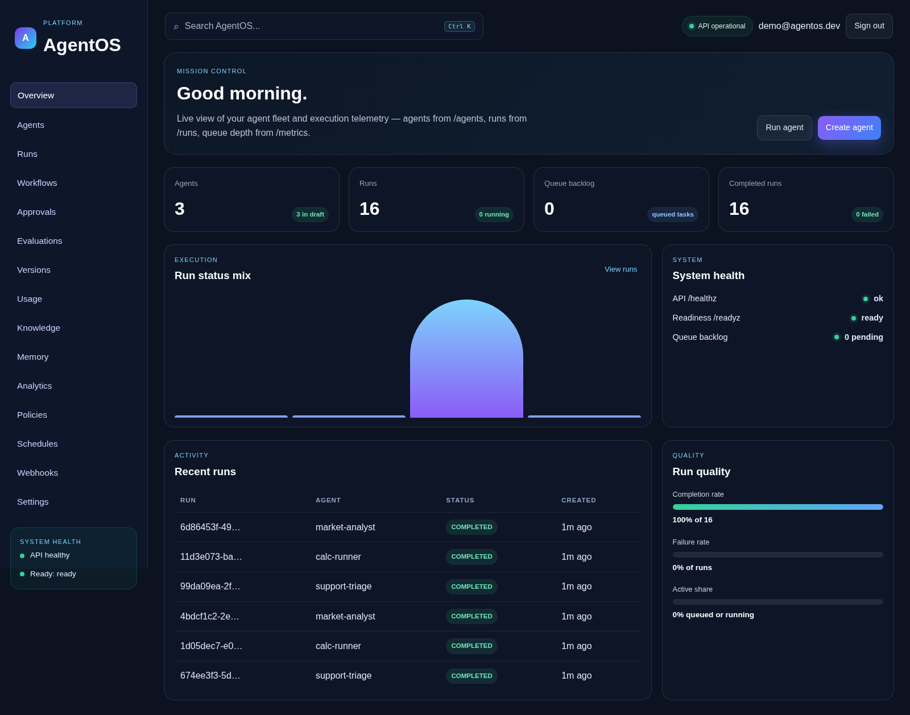
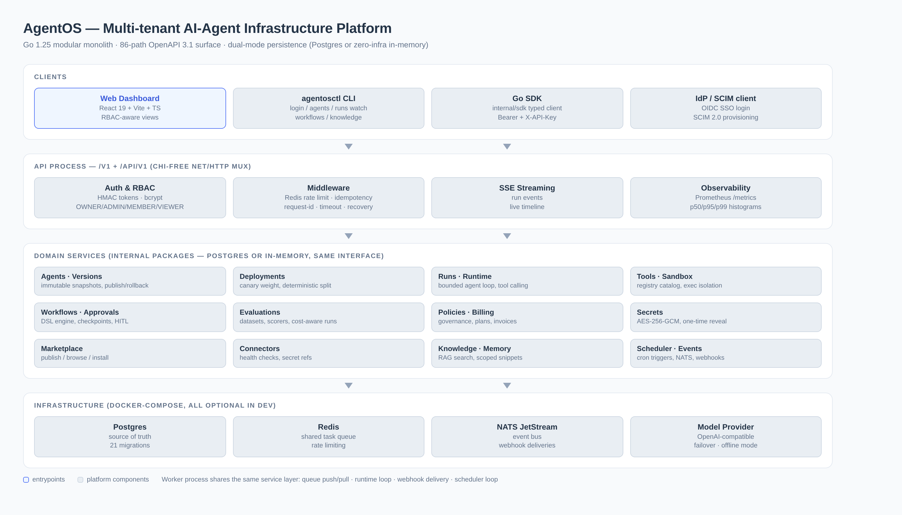
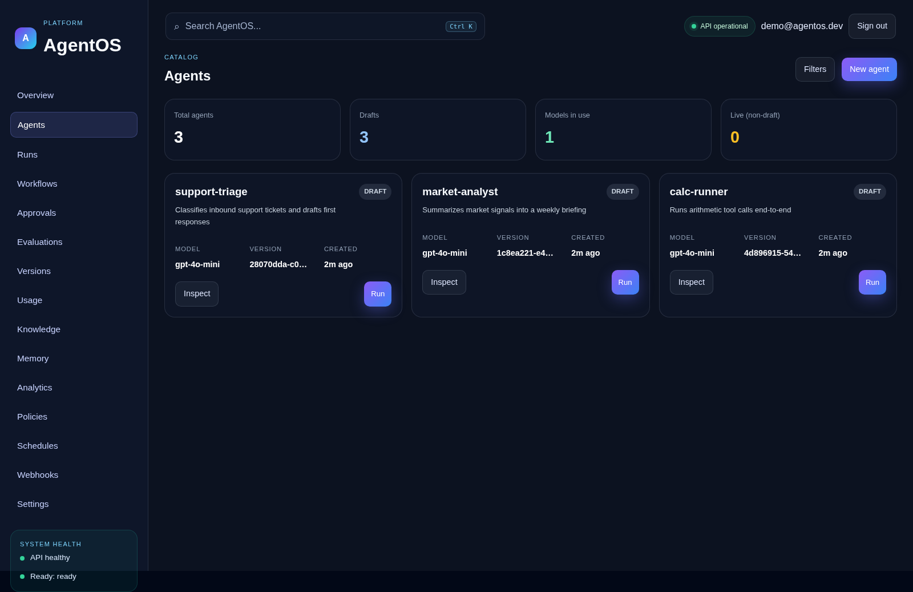
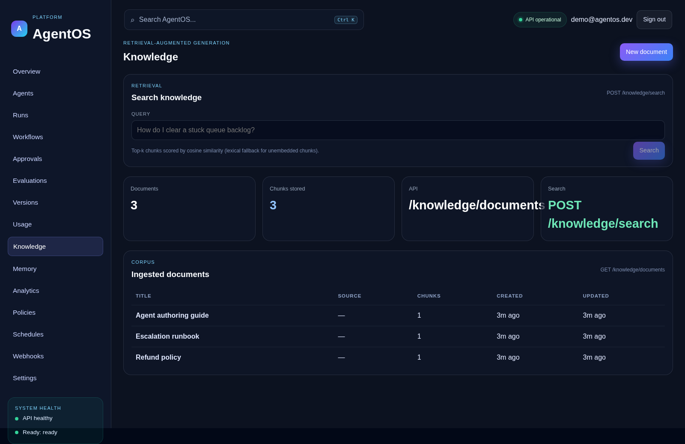
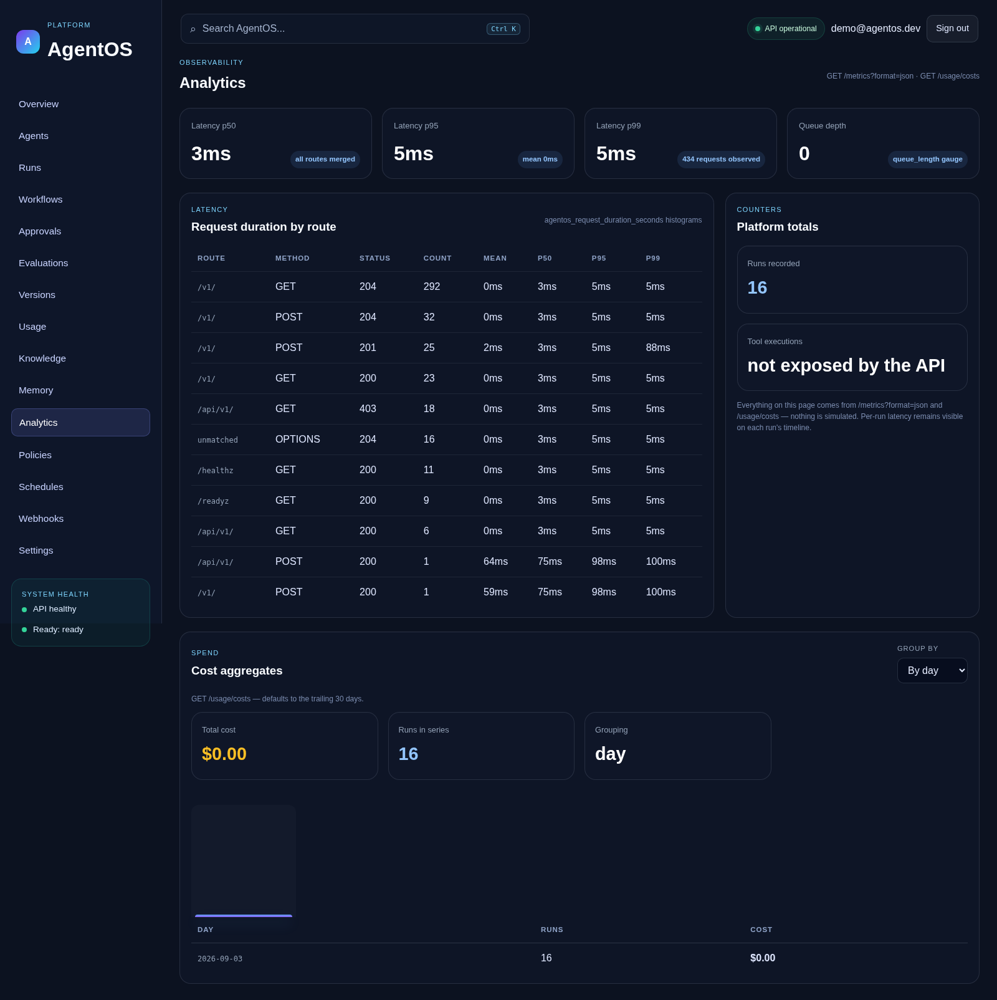
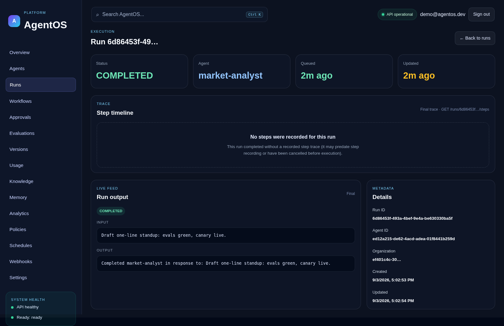

<div align="center">

# AgentOS

**A multi-tenant AI-agent infrastructure platform — built in Go, operated like a product.**

[](https://github.com/Roy-Wanyoike/AI-Agentic-Infrastructure-Platform/actions/workflows/ci.yml)


[](./LICENSE)

**Author agents → version them → deploy with canary traffic splits → run on a durable queue → evaluate, govern, observe, and bill for every token.**

</div>

---

AgentOS is the control plane for running AI agents in production: a Go 1.25 modular monolith (47 internal packages, one deployable API process + one worker) with a React 19 dashboard, a 182-path OpenAPI 3.1 contract (531 schemas), and **dual-mode persistence** — the exact same binary runs against Postgres for production or fully in-memory with zero infrastructure for development and CI. Every tenant boundary, permission check, and retry path is enforced in code and exercised by tests, not promised in docs.



## What's inside

| Area | Capabilities |
|---|---|
| **Agents & versions** | Agent CRUD (update/delete included), immutable config versions, publish/rollback, per-agent tool attachments, **enforced lifecycle state machine** (draft → building → active → paused → disabled → archived with audited transitions + run-creation gate), **export/import/clone portability** (deterministic bundles, secret values never exported, dependency validation, cross-org sharing) |
| **Deployments** | Promote/rollback **plus canary deployments** — weighted traffic split with deterministic per-agent stickiness (FNV-1a bucketing), now **eval-gated auto-promotion/rollback**: set pass-rate/p95/cost thresholds and the canary promotes or rolls itself back with an audited reason — CI/CD for agents |
| **MCP gateway** | Bidirectional **Model Context Protocol**: every tenant's tool registry exposed over MCP (JSON-RPC 2.0, `POST /v1/mcp`) so Claude, Cursor, or any MCP client reaches a governed, permission-scoped, audit-logged tool surface — and an **org-scoped MCP client + registry** (`/v1/mcp-servers`) so your agents can *consume* external MCP servers: health-checked registration, cached tool catalogs, secret-ref auth by name, per-org runner isolation, **trust layer**: toolset fingerprints + drift history (`/v1/mcp-servers/{id}/drift`), version **pinning with rug-pull detection** (pinned servers keep their cached tools on toolset drift until an explicit accept), and an opt-in prompt-injection arg scanner that records findings in the audit trail |
| **Runs & runtime** | Bounded agent loop (max steps, wall-clock + per-tool timeouts, loop detection), OpenAI-compatible **model provider with failover**, offline deterministic mode for zero-infra dev, **conversation history strategies** (sliding-window / summarize / drop-oldest) + **token budgets** (alert threshold + hard stop) + **graceful shutdown** (worker drain), **complete run lifecycle** (`/runs/{id}/pause|resume|cancel` with enforced state machine, durable per-step checkpoints, stale-run recovery sweeper, `run.paused/resumed/cancelled` events), **run trace exposure** (`GET /runs/{id}/trace` linking the run's W3C trace), **batch operations** (`/batch/*` bulk runs/workflows/updates/cancels with per-item results, SSE progress, partial-failure isolation) |
| **Tools & sandbox** | Tool registry with input schemas (`GET /v1/tools`), calculator + HTTP tools, opt-in **process-isolated sandbox execution** (rlimits, output caps, env scrubbing), **expanded builtin catalog**: database (parameterized SQL, read-only default, audited), search (web/knowledge/hybrid re-ranked), sandboxed code execution, HMAC-signed SSRF-guarded webhook, jq-like JSON transform, per-org file storage |
| **Workflows & approvals** | JSON-DSL multi-agent workflows, durable checkpointed node execution with recovery/watchdog, human-in-the-loop approval gates, **conditional execution** (if/switch/loop/retry/wait-until over a safe stdlib expression engine + `POST /workflows/validate`), **true parallel branches** (all/any/race/majority aggregation, concurrency limits, per-branch timeouts, fail-fast/collect-all) |
| **Evaluations** | Datasets, scorers, eval runs with per-case **token usage & cost** via a model-pricing hook |
| **Orchestration & models** | **Agent-to-agent orchestration executor** (comm bus with org-scoped inboxes, delegation protocol with depth limits + approval routing, supervisor: round-robin / least-loaded / capability-match), **advanced model router** (cost/latency/complexity/round-robin/weighted over a capability registry, per-provider circuit breakers), **LLM response resilience** (capability detection, JSON negotiation + bounded repair, reasoning-wrapper stripping, token-limit retry, backoff w/ jitter) |
| **Governance** | **Granular rate limiting** (org → agent → tool → model hierarchy, RPM/RPD/TPM sliding windows on Redis + in-memory, per-scope CRUD at `/rate-limits`, 429 `rate_limited` + Retry-After at run/tool/model seams); **Enforced policy engine** — allow/deny decisions gate run creation AND every tool invocation at the runtime seam (deny → visible `policy_denied`, over-budget → blocked, `require_approval` → WAITING_APPROVAL; verdict recorded on the run timeline so the UI shows *why*); Redis rate limiting, idempotency keys, org-scoped audit trail (`/v1/audit-events`) with a **tamper-evident hash chain** (`GET /v1/audit/verify` + deterministic JSONL evidence export with a WORM-anchor head hash — SOC 2 / EU AI Act Art. 12 evidence), readable event stream (`/v1/events`) with dashboard activity feed, organization & member management (roles, last-owner guards, SCIM-consistent deactivation), **token lifecycle**: logout, single-use refresh, server-side revocation deny-list (SCIM-deprovisioned users can't refresh) |
| **Agent identity & budgets** | **Agent-scoped API keys with tool allow-lists** (`ak_` keys bound to one agent: nil list = all tools, empty = none, listed = least privilege — enforced at the runtime tool seam with `agent_key_tool_not_allowed` denials + audit rows; non-human identity v1) and **per-scope budget gates** (`/v1/budgets` — organization or agent monthly limits on runs and cost with a dry-run evaluate endpoint; enforcement shares the quota flag: 402 `budget_exceeded` at run creation + worker pre-execution) plus **showback/chargeback reports** (`/v1/showback` per-agent usage & cost rollups for FinOps and reseller economics) |
| **Interop, oversight & compliance** | **A2A agent-to-agent protocol** (org-scoped **Agent Card registry** — publish/discover cards, canonical card JSON at `/v1/a2a/agents/{id}/card`, governed inbound messages that create real runs, **policy-gated outbound delegation** with `delegation_denied` verdicts + audit); **enterprise approvals** (delegation chains with expiry + lazy return, **escalation SLAs** with an idempotent sweep endpoint, **two-person dual control** that blocks self-approval with `dual_control_self_approval`, byte-deterministic oversight **evidence export** for EU AI Act Art. 14); **compliance evidence pack** (control mapping across SOC 2 TSC / ISO 42001 / EU AI Act / NIST AI RMF with live evidence pointers — audit chain head, canary policy state, SCIM/SSO posture — plus Annex-IV-style per-agent **technical documentation** and a deterministic evidence bundle); **model gateway virtual keys** (`vk_` keys with model allow-lists and enforced monthly spend caps — 402 `spend_limit_exceeded` *before* the provider call, per-key/month spend ledger, `GuardedProvider` seam in the worker); **data residency** (org region pinning, data-flow-aware endpoint classification with strict fail-closed mode, `residency_violation` audit events, posture surface) |
| **Billing & secrets** | Plans, subscriptions, **enforced quota gates** (402 `quota_exceeded` at the run path when `AGENTOS_BILLING_ENFORCEMENT=on`), usage-derived invoices reconciled with the runs cost ledger, usage **meters + per-tenant margin**, optional idempotent **Stripe usage-record sync** (zero deps, no-op without a key); **AES-256-GCM encrypted secrets** with one-time reveal; self-service API keys (mint once, hash at rest) |
| **Marketplace & connectors** | Publish/browse/install agent templates across organizations with **publisher provenance**: Ed25519 detached signatures over a canonical manifest, verified at publish AND at install (tampered snapshots and revoked keys are blocked; unsigned installs need an explicit per-org opt-in), verifiable `GET /marketplace/listings/{slug}/provenance`; external integrations with health checks and secret refs |
| **SSO & SCIM** | OIDC browser login (manual JOSE, RS256 via stdlib) with JIT provisioning; **SCIM 2.0** user lifecycle with hashed provisioning tokens |
| **Knowledge & memory** | RAG document store with chunking + semantic search, scoped agent memory snippets, **real embedding providers** (OpenAI embeddings + pgvector HNSW, hybrid keyword+vector fusion / RRF; offline hash embedder stays the zero-infra default) |
| **Events & scheduling** | NATS JetStream event bus, webhook deliveries with retries, **notification subscriptions** (org-scoped operational alerts for run failures / approvals / canary rollbacks over the signed webhook pipeline), **queue introspection + DLQ requeue** (list, inspect, and revive dead-lettered tasks — `queue.manage`), cron scheduler with catch-up |
| **Observability** | Prometheus text `/metrics` (bucketed p50/p95/p99 histograms, run/tool counters), **OpenTelemetry distributed tracing** (`AGENTOS_TRACING_ENABLED`, default off with a byte-identical fast path; OTLP export, W3C propagation), a **measured load-test baseline** with a reproducible harness (`scripts/loadtest`), structured logging, health/readiness probes, SSE run-event streaming |
| **Developer experience** | `agentosctl` CLI + typed Go SDK covering every vertical (billing, secrets, marketplace, connectors, SSO, API keys), seeded demo data, Makefile targets, GitHub Actions CI with gofmt/vet/test/build + **race-detector job** + web build gates; the dashboard covers every engine — canary controls, identity/SCIM admin, ops/DLQ panel, tools registry and the audit trail included; **six-scenario load suite** (`loadtest/`: sustained/spike/soak/concurrency/workflow/lifecycle with recorded baselines + regression comparator) |
| **Synthetic assurance (flagship)** | **AI synthetic users & continuous product assurance**: tenant-scoped registry for projects/targets/environments/personas with target ownership verification and production read-by-default posture (`/synth/*`); **isolated browser + API test workers** (versioned run state machines, bounded steps/time, evidence capture with redaction, stale-run recovery, inconclusive ≠ fail); **9 built-in personas + versioned journeys** with mandatory explicit assertions (model confidence can never pass a run), capability coverage mapping, synthetic-only fixture guards; **evidence bundles + finding lifecycle** (confirmed/likely/flaky/harness/environmental/inconclusive, stable fingerprint dedup with append-only occurrences, independent reproduction — never replaying production writes); **GitHub findings sync** (least-privilege client, idempotent issue create/update, secret scrubbing, draft-until-approved regression-test generation, fix verification); **unified release quality gates** (versioned policies over evaluations + journeys + adversarial security + canary health, tamper-evident evidence records, deterministic promote/hold/abort/rollback, time-bounded audited exceptions, security suites fail-closed); **adversarial evaluations** (prompt injection, permission bypass, cross-tenant probes, secret exposure — asserting enforcement at control boundaries, never model refusal); **safety-bounded autonomous exploration** (scope-checked navigation, budget/kill-switch bounded, draft candidates require approval) + **continuous production journeys** (timezone-aware schedules, quiet windows, kill switches) + **release-version comparison** (same versioned inputs, meaningful-delta reports) |
| **Visual builders & DX** | **Visual workflow builder** (hand-rolled SVG DAG canvas — 12 node types, pan/zoom/drag/connect, minimap, auto-layout, live client+server validation via `POST /workflows/validate`, DSL JSON round-trip, SVG export), **visual agent builder** (8-step wizard, 6 templates, JSON-aware diff view, live streamed preview), **real-time trace viewer** (execution waterfall, per-step token/cost attribution, SSE live-append, trace-id chip), **cost analytics** (spend trends daily/weekly/monthly, agent efficiency, model cost comparison, budget forecasting with alerts, CSV export), **developer portal** (offline-generated API reference over the full spec, interactive playground, Go SDK + CLI quickstarts, onboarding guides) |
| **Knowledge graph & simulation** | **Dynamic graph memory** (agent activities auto-ingested as episodes with time-decay relevance and temporal queries), **ontology-first construction** (deterministic + LLM schema generation with naming-convention enforcement, fallback-type guarantees, schema-validated extraction), **tiered retrieval tools** (quick/panorama/insight tiers with auto query decomposition and synthesis — policy-restrictable), **graph lifecycle locks** (read leases + exclusive write locks for safe resets), **cross-platform simulation engine** (social/market/network adapters, deterministic seeded rounds, emergence heuristics), **ReACT agent pattern** (multi-tool steps, reflection rounds with quality self-assessment, long-output sectioning), **LLM-driven auto-configuration** (natural-language → validated agent/workflow drafts, step-by-step generation with progress) |
| **Deployment artifacts** | Production **Kubernetes manifests** (HPAs, PDBs, NetworkPolicies, StatefulSets), **Helm chart** (BYO dependencies, OTEL sidecar option), **Terraform modules** (RDS/CloudSQL, ElastiCache/Memorystore) with dev/staging/production roots, **Kustomize overlays** — see `deploy/README.md` |

## Architecture

Dual-mode by design: in Postgres mode every service persists through a tenant-guarded store; in memory mode the same interfaces run on maps — which is why the full test suite (50 packages) runs in seconds with no containers.



## A tour of the dashboard

| | |
|---|---|
|  |  |
| **Agents** — fleet catalog with models, versions, one-click runs | **Knowledge** — RAG corpus with semantic search |
|  |  |
| **Analytics** — real latency percentiles, run counters, cost aggregates (nothing simulated) | **Run detail** — status, input/output, live SSE event feed |

Every number on the analytics page comes from `/metrics?format=json` and `/usage/costs` — where the API doesn't expose a metric, the UI says so instead of inventing one.

## Quick start

**Zero infrastructure (in-memory mode):**

```bash
go run ./cmd/api                       # API on :8080
# second terminal
AGENTOS_API_PULL=true AGENTOS_API=http://localhost:8080 \
  AGENTOS_API_KEY=<dev-key-from-api-log> go run ./cmd/worker
# third terminal
cd web && npm install && npm run dev   # dashboard on :5173
```

**Full stack (durable mode):**

```bash
cp .env.example .env
make docker-up      # Postgres, Redis, NATS
make migrate-up     # apply the 37 migrations
make seed           # demo org + agents + workflow + runs
make run-api        # API on :8080
make run-worker     # run execution (second terminal)
```

Demo login: `demo@agentos.dev` / `demo-password` (override with `AGENTOS_SEED_PASSWORD`).

**Production, one command:**

```bash
docker compose -f docker-compose.prod.yml up -d --build   # api + worker + web + Postgres/Redis/NATS + one-shot migrate
```

Distroless images, healthchecks, SPA proxy with SSE support — see [docs/self-hosting.md](docs/self-hosting.md) for the full env matrix, backups, and upgrades.

The API mounts every route twice — `/v1/...` (legacy) and `/api/v1/...` (canonical, used by the dashboard) — from one contract: [`api/openapi.yaml`](api/openapi.yaml).

## Talk to the API

```bash
TOKEN=$(curl -s -X POST localhost:8080/v1/auth/login \
  -H 'Content-Type: application/json' \
  -d '{"email":"demo@agentos.dev","password":"demo-password"}' | jq -r .token)

# create an agent
curl -s -X POST localhost:8080/v1/agents/create \
  -H "Authorization: Bearer $TOKEN" -H 'Content-Type: application/json' \
  -d '{"name":"support-triage","model":"gpt-4o-mini","description":"Classify tickets","instructions":"Classify urgency, draft a reply."}'

# run it (queued → picked up by the worker → step trace + cost)
curl -s -X POST localhost:8080/v1/runs \
  -H "Authorization: Bearer $TOKEN" -H 'Content-Type: application/json' \
  -d '{"agent_id":"<agent-id>","input":"Ticket #4830: password reset loop"}'

# canary: route 20% of a fleet to the new version — with an eval gate
# (auto-promotes or auto-rolls-back once the canary window has enough scored runs)
curl -s -X POST localhost:8080/v1/deployments/<id>/canary \
  -H "Authorization: Bearer $TOKEN" -H 'Content-Type: application/json' \
  -d '{"canary_version":"<version-id>","canary_weight":20,
       "canary_policy":{"min_pass_rate":0.9,"min_canary_runs":10}}'

# connect any MCP client (Claude Desktop, Cursor, ...) to your tenant's tools
curl -s -X POST localhost:8080/v1/mcp \
  -H "Authorization: Bearer $TOKEN" -H 'Content-Type: application/json' \
  -d '{"jsonrpc":"2.0","id":1,"method":"tools/list"}'
```

**CLI and SDK:**

```bash
go build -o agentosctl ./cmd/agentosctl
./agentosctl login --email demo@agentos.dev
./agentosctl agents list
./agentosctl runs watch <run-id>        # live step stream until terminal
```

```go
client := sdk.New("http://localhost:8080", sdk.WithAPIKey(key))
agents, _ := client.Agents().List(ctx)
run, _ := client.Runs().Create(ctx, agentID, "classify this ticket")
```

## Engineering discipline

- **Contract-first**: the 182-path OpenAPI 3.1 spec (531 schemas) is regression-tested by `internal/apispec` — a dangling `$ref`, duplicate `operationId`, or path without operations fails CI (mutation-verified).
- **Tenant isolation everywhere**: every Postgres query carries an `organization_id` guard; tenant identity comes from signed claims, never from client payloads.
- **Security by default**: bcrypt passwords, HMAC-signed session tokens, hashed API keys and SCIM tokens, AES-256-GCM secrets at rest with key-versioned envelopes, OWNER-gated one-time secret reveal (audit-logged).
- **Honest observability**: metrics are incremented at the point of truth (run terminal transitions, tool executions); the dashboard renders "not exposed by the API" rather than fake numbers — no silent mocking, as a product rule.
- **Verified before merged**: every feature landed through a PR gated on `gofmt`, `go vet`, `go build`, and the full `go test -count=1 ./...` suite (50 packages, race-clean; a dedicated `-race` CI job runs the whole tree).

```bash
make lint && make verify    # gofmt + vet + build + test
```

## Project structure

```text
├── api/openapi.yaml          # canonical OpenAPI 3.1 contract (182 paths)
├── api/fragments/            # per-track spec fragments, merged into the main spec
├── cmd/
│   ├── api/                  # HTTP process: routes, handlers, middleware wiring
│   ├── worker/               # run execution, scheduler loop, webhook delivery
│   ├── agentosctl/           # CLI (all verticals)
│   ├── healthcheck/          # static probe for the distroless images
│   ├── sandbox-exec/         # process-isolated tool sandbox
│   ├── seed/                 # idempotent demo seeder
│   └── migrate/              # migration runner (env-aware)
├── internal/                 # 47 domain packages — agents, deployments, runs,
│   │                         # runtime, workflows, evaluations, policies, billing,
│   │                         # secrets, marketplace, connectors, mcp, sso, scim,
│   │                         # sandbox, knowledge, memory, events, scheduler …
├── migrations/               # 37 tenant-guarded SQL migrations
├── web/                      # React 19 + Vite + TypeScript dashboard
├── docs/architecture.md      # factual architecture walkthrough
├── docs/self-hosting.md      # production deployment guide
├── Dockerfile.api/worker/web # distroless + nginx production images
└── docker-compose*.yml       # dev infra + full production stack
```

## Docs

- [Architecture walkthrough](docs/architecture.md)
- [Synthetic assurance — flagship closure evidence](docs/synthetic-assurance.md)
- [OpenAPI contract](api/openapi.yaml) — import into Swagger UI / Postman
- [Implementation plan](docs/agentos-implementation-plan.md)
- [Contributing](CONTRIBUTING.md) — setup, quality gates, PR rules
- [Security policy](SECURITY.md) — private disclosure and SLAs

## License

Apache-2.0 — see [LICENSE](LICENSE).

## Built in the open

AgentOS is developed with a multi-agent workflow: a contract is pinned first (endpoints, JSON shapes, RBAC, migration numbers, file ownership), specialized agents implement disjoint tracks in parallel, and every track ships only after the full verification gate — then lands through a PR that references the issue it closes. The repository history reads as the audit log of that process: wave by wave, from persistence to canary deployments to SSO to an MCP gateway.
